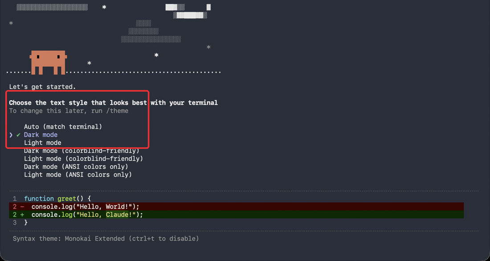
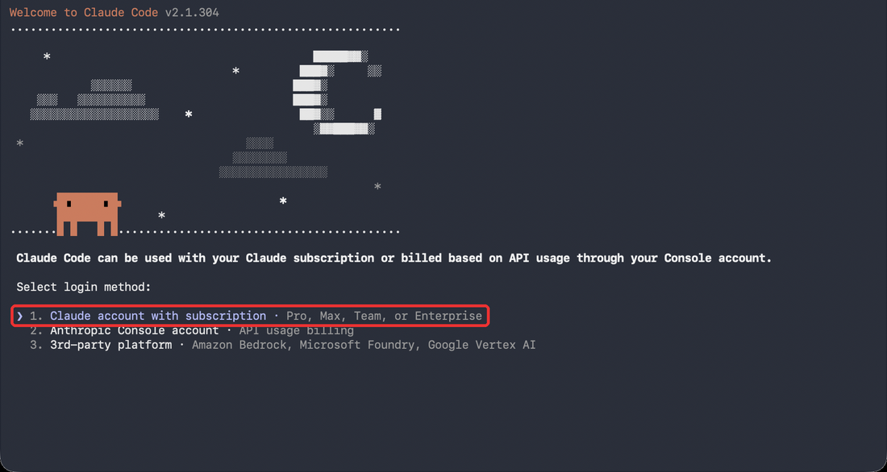
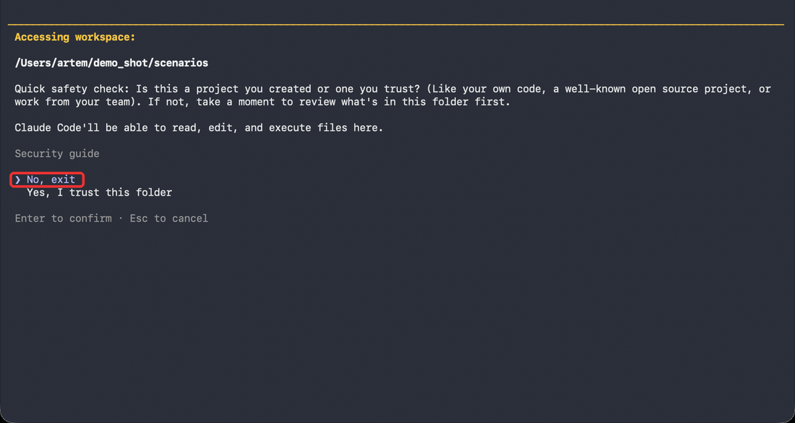
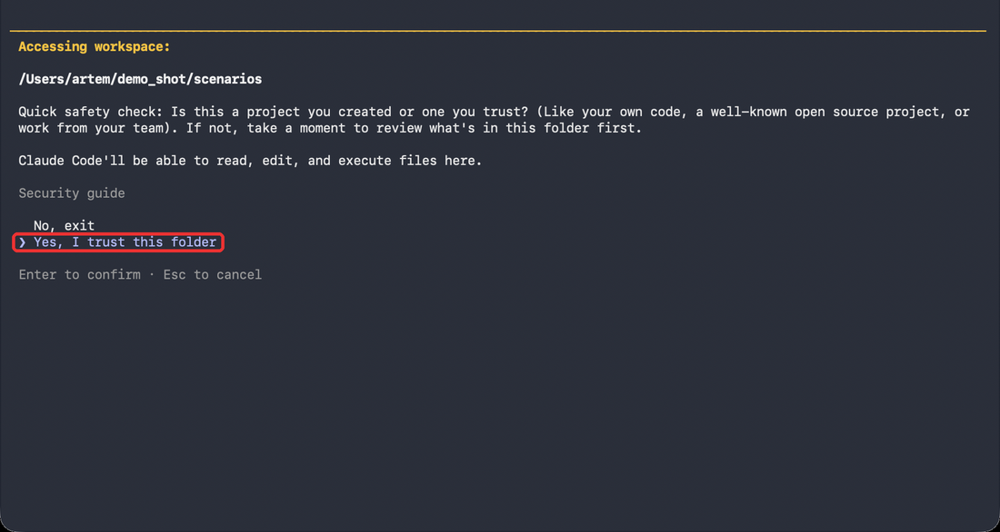
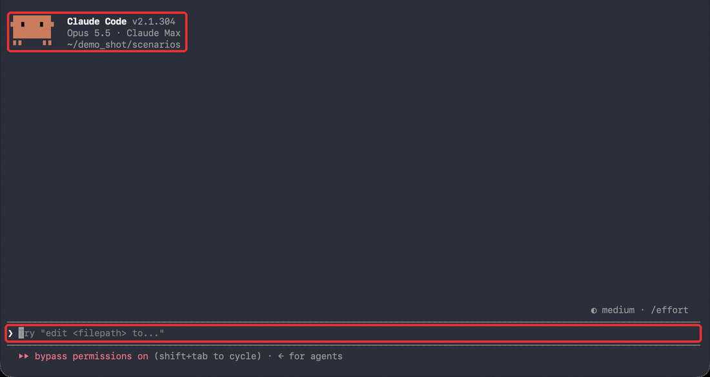

# Урок 1. Сценарии

Система каждую ночь смотрит блогеров твоей ниши, находит ролики, которые залетели, и пишет по ним сценарии под тебя. Утром сценарии приходят в Telegram, все идеи лежат на сайте у тебя на компьютере.

Делай шаги строго по порядку. Текст в серых блоках копируй целиком: наведи мышку на блок, справа появится кнопка копирования.

---

## Что нужно заранее

- Компьютер на Mac или Windows. Ночью он должен быть включён, система работает в 03:00.
- Google Chrome.
- Подписка Claude Pro или Max на claude.ai.
- Отдельный аккаунт Instagram, не основной. Создай его за пару дней до урока и полистай с телефона ленту, чтобы аккаунт выглядел живым.
- Telegram.

---

## Шаг 1. Установить Claude Code · 5 минут

### Mac

1. Нажми Cmd + пробел, набери «Терминал», нажми Enter.
2. Вставь команду и нажми Enter. Попросит пароль от компьютера: вводи, символы не видны, это нормально.
   ```
   /bin/bash -c "$(curl -fsSL https://raw.githubusercontent.com/Homebrew/install/HEAD/install.sh)"
   ```
3. Вставь команду и нажми Enter:
   ```
   curl -fsSL https://claude.ai/install.sh | bash
   ```
4. Закрой Терминал: Cmd + Q. Установка закончена, переходи к шагу 2.

### Windows

1. Нажми Пуск, набери PowerShell, открой.
2. Вставь команду и нажми Enter. Если Windows спросит разрешение – «Да».
   ```
   winget install --id Git.Git -e
   ```
3. Вставь команду и нажми Enter:
   ```
   irm https://claude.ai/install.ps1 | iex
   ```
4. Закрой PowerShell: крестик в углу окна. Установка закончена, переходи к шагу 2.

---

## Шаг 2. Первый запуск и вход в Claude · 5 минут

**Сначала главное.** Claude Code – это не приложение Claude с полем «Напишите сообщение». Он работает внутри окна Терминала (Mac) или PowerShell (Windows): тёмное или синее окно с текстом. Если ты видишь в этом окне надписи Claude Code – это он и есть, отдельное приложение открывать не нужно.

В этом окне почти всё делается клавишами:
- стрелки ↑ ↓ – передвинуть значок `❯` на нужный вариант;
- Enter – выбрать вариант, на котором стоит `❯`;
- вставить скопированный текст: Mac – Cmd + V, Windows – Ctrl + V или правый клик мышкой.

Картинки ниже сняты на Mac. На Windows окно синее, а текст и варианты те же.

### 2.1. Открой окно

- **Mac:** Cmd + пробел → набери «Терминал» → Enter.
- **Windows:** Пуск → набери PowerShell → открой.

### 2.2. Запусти Claude

Напиши в окне `claude` (маленькими латинскими буквами, без кавычек) и нажми Enter:
```
claude
```

Если появилось `command not found: claude` (Mac) или красный текст, что `claude` не найден (Windows), – вставь команду для своей системы, нажми Enter, закрой окно, открой заново и снова набери `claude`.

Mac:
```
echo 'export PATH="$HOME/.local/bin:$PATH"' >> ~/.zshrc
```
Windows:
```
[Environment]::SetEnvironmentVariable("Path", [Environment]::GetEnvironmentVariable("Path", "User") + ";$env:USERPROFILE\.local\bin", "User")
```

### 2.3. Смотри, что появилось

- Наверху **Let's get started**, ниже список **Dark mode, Light mode…** – ты запускаешь Claude первый раз. Иди по пунктам 2.4–2.7.
- Наверху **Accessing workspace** – сразу к пункту 2.6.
- Наверху рыжий значок и **Claude Code**, внизу строка со значком `❯` – ты уже вошла раньше. Сразу к пункту 2.7.

### 2.4. Цвет текста

Экран «Choose the text style» – это выбор цвета текста в окне. Ничего не меняй, просто нажми **Enter**.



### 2.5. Способ входа

Экран «Select login method». Значок `❯` уже стоит на **1. Claude account with subscription** – нажми **Enter**.



Сам откроется браузер с сайтом Claude:
1. Войди в аккаунт, где оплачена подписка Pro или Max.
2. Нажми **Authorize**.
3. Вернись в окно Терминала или PowerShell.

Если браузер не открылся – в окне будет длинная ссылка. Скопируй её целиком и открой в браузере.

Дальше могут появиться ещё 1–2 экрана на английском: «Login successful», заметки о безопасности, настройка терминала. На каждом просто нажми **Enter**.

### 2.6. Доверие папке – здесь все ошибаются

Экран «Accessing workspace» – Claude спрашивает, можно ли ему работать в этой папке.

Значок `❯` стоит на **No, exit**. Если сразу нажать Enter – Claude закроется.



Нажми **стрелку вниз ↓** – значок `❯` встанет на **Yes, I trust this folder**. Теперь нажми **Enter**.



Если всё-таки закрылся – ничего страшного: набери `claude`, нажми Enter и в этот раз сначала стрелку вниз.

### 2.7. Claude открыт

Так выглядит окно, в котором Claude готов к работе. Наверху рыжий значок и **Claude Code**, внизу строка со значком `❯`. В эту строку ты вставляешь задания из следующих шагов и нажимаешь Enter.



Путь под надписью Claude Code у тебя будет свой – это папка, где ты сейчас находишься. Красной надписи **bypass permissions on** внизу сейчас может не быть – она появится, когда будешь открывать систему командой из раздела «Как открывать систему».

Когда Claude попросит разрешение запустить команду, выбирай **Yes**. Чтобы не нажимать каждый раз, выбирай **Yes, and don't ask again**.

---

## Шаг 3. Ключи и бот · 10 минут

Открой «Заметки» или «Блокнот» и складывай туда всё, что скопируешь. Ключи никому не пересылай.

1. **Ключ Groq** – обязательно. Расшифровка роликов, бесплатно, карта не нужна.
   console.groq.com → войти через Google → слева **API Keys** → **Create API Key** → скопировать.
2. **Telegram-бот** – обязательно. Сюда приходят сценарии.
   В Telegram найди **@BotFather** → отправь `/newbot` → придумай имя → придумай ник, который заканчивается на `bot` → скопируй токен (длинная строка с двоеточием).
   Потом открой своего бота по ссылке от BotFather, нажми **Старт** и напиши ему «привет».
3. **Ключ Gemini** – запасной, можно пропустить.
   aistudio.google.com/api-keys → **Create API key** → скопировать.
4. **Ключ ElevenLabs** – второй запасной, можно пропустить.
   elevenlabs.io → слева **Developers** → **API Keys** → создать, включить **Speech to Text** → скопировать сразу, ключ показывается один раз.

Если ты в России: Gemini и ElevenLabs без VPN не работают, пропусти их. Хватит Groq.

---

## Шаг 4. Установить систему · 15 минут

Вставь в Claude текст целиком и нажми Enter:

```
Установи мне систему сценариев. Делай сам, команды запускай сам, у меня спрашивай только ключи.

1. Определи систему: macOS или Windows.
2. Если нет, установи Python 3.11 или новее и ffmpeg. Mac – brew install python ffmpeg; если brew не находится, используй /opt/homebrew/bin/brew и добавь его в PATH навсегда: строку eval "$(/opt/homebrew/bin/brew shellenv)" в ~/.zprofile. Windows – winget install Python.Python.3.12 и winget install Gyan.FFmpeg. Проверь, что установлен Google Chrome.
3. Скачай https://github.com/artemregi/scenarios/archive/refs/heads/main.zip и распакуй в мою домашнюю папку так, чтобы получилась папка scenarios, а внутри сразу файлы install.py, run.py и другие. Если папка scenarios уже есть – не трогай в ней .env, anketa.md, knowledge, bloggers.txt, ig_profile и data, остальные файлы замени.
4. В папке scenarios запусти install.py (Mac – python3 install.py, Windows – python install.py). Если на Windows python не находится или открывает Microsoft Store – используй py -3.12.
5. Открой файл .env в папке scenarios. По очереди попроси у меня ключи и впиши: GROQ_API_KEY, TELEGRAM_BOT_TOKEN, GEMINI_API_KEY, ELEVENLABS_API_KEY. Если ключа нет – пропусти. Значения ключей никогда не выводи на экран.
6. Узнай мой chat_id: запроси getUpdates у моего бота (я уже написал ему «привет») и впиши TELEGRAM_CHAT_ID в .env.
7. Запусти login.py – откроется Chrome. Скажи мне войти в мой отдельный аккаунт Instagram и жди, пока окно закроется само.
8. Запусти doctor.py --full и покажи таблицу целиком. Строки «Паспорт, стиль, правила, блогеры», Gemini и ElevenLabs могут быть ❌ – это нормально. Всё остальное должно быть ✅. Если нет – почини и проверь ещё раз.
9. Отправь в мой бот сообщение «Система установлена».
10. В конце напиши мне: «Закрой это окно. Дальше открывай Claude так: cd ~/scenarios, потом claude --dangerously-skip-permissions».
```

**Готово, когда** в Telegram пришло «Система установлена».

Закрой окно, как скажет Claude.

---

## Как открывать систему (каждый раз)

Так открываешь Claude перед каждым следующим шагом и вообще каждый раз, когда работаешь с системой. Не через приложение Claude, а так:

1. Открой Терминал (Mac) или PowerShell (Windows) – как в пункте 2.1.
2. Вставь команду и нажми Enter. Она переводит окно в папку системы:
   ```
   cd ~/scenarios
   ```
   Появится только новая строка – так и должно быть. Если пишет `no such file` или `Cannot find path` – система не установлена, вернись к шагу 4.
3. Вставь команду и нажми Enter. Она запускает Claude так, чтобы он сам запускал команды и не спрашивал каждый раз разрешения:
   ```
   claude --dangerously-skip-permissions
   ```
4. В первый раз в этой папке появится экран «Accessing workspace»: **стрелка вниз ↓**, потом **Enter** – как на картинке в пункте 2.6.
5. В первый раз с этой командой может появиться предупреждение на английском со словами **Bypass Permissions**. Стрелкой вниз ↓ выбери **Yes, I accept** и нажми **Enter**.
6. Готово, когда видишь окно как на картинке ниже: внизу строка со значком `❯` и красная надпись **bypass permissions on**.


Все следующие шаги вставляй в Claude, открытый так.

---

## Шаг 5. Паспорт блога · 15 минут

Паспорт – кто ты, кто твой зритель, что у него болит и как ты говоришь. По нему система ищет блогеров, отбирает идеи и пишет сценарии.

Приготовь ники 3–5 блогеров, у которых залетают ролики, и 2–3 ссылки на свои рилсы, где ты говоришь в кадре.

```
Открой anketa.md. Задавай мне вопросы из неё по одному разделу, жди моего ответа и записывай ответ в файл моими словами. Если я не знаю – оставь пустым, не придумывай.
Когда все 8 разделов заполнены, запусти passport.py. Потом покажи мне knowledge/passport.md и knowledge/style.md целиком и спроси, что поправить. Мои правки внеси в эти файлы сам.
```

**Проверь:** в паспорте боли зрителя твоими словами, а не общими. В style.md твои настоящие фразы, а не «дружелюбный тон».

---

## Шаг 6. Конкуренты: находим блогеров ниши · 10 минут

Система разбирает твоих блогеров: о чём пишут, что у них залетает. По этому и по паспорту ищет похожих в Instagram и оценивает каждого.

```
Запусти discover.py – он разберёт профили моих блогеров из bloggers.txt, поймёт, что у них общего, и по этому и моему паспорту найдёт новых. Это займёт 5–10 минут, не прерывай.
Потом скажи, что общего нашлось у моих блогеров, и покажи найденных таблицей: ник, оценка, подписчики, почему. Спроси, кого добавить.
Тех, кого я выберу, добавь в bloggers.txt. Если скажу «всех хороших» – запусти discover.py --add 7.
```

**Как выбирать:** аудитория похожа на твою, не миллионники, регулярно выкладывают рилсы. Можно соседнюю нишу и англоязычных. Итого в списке 5–10 блогеров.

---

## Шаг 7. Находим залёты · 15 минут

Залёт – ролик, который набрал минимум в 2 раза больше просмотров, чем обычно у этого автора. Эту тему зрители уже проверили.

```
Запусти collect.py – он посмотрит моих блогеров из bloggers.txt и найдёт ролики, которые залетели.
Между блогерами паузы до минуты, это нормально – так бережём аккаунт. Не прерывай.
В конце покажи таблицу залётов.
```

**Проверь:** у каждого блогера есть «обычно N просмотров» и хотя бы 1–2 залёта. Если написано «роликов не видно» – проверь ник.

Если Instagram просит подтвердить вход – скажи Claude «запусти login.py», войди и подтверди. Если аккаунт ограничили – не запускай сбор 1–2 дня.

---

## Шаг 8. Расшифровка и разбор · 10 минут

```
Запусти transcribe.py – он расшифрует залёты.
Потом возьми из data/reels.db три залёта с самым большим множителем и для каждого ответь коротко:
- о чём ролик одной фразой;
- какую боль или желание задел;
- чем зацепил в первые 3 секунды;
- на чём держится (история, метафора, контраст, список, ограничение);
- как перенести это на мою тему из knowledge/passport.md.
```

**Проверь:** открой один ролик по ссылке и сверь первые фразы с расшифровкой.

---

## Шаг 9. Первые сценарии · 10 минут

```
Запусти write.py 3 – он оценит идеи, напишет 3 сценария, проверит их и пришлёт мне в Telegram.
Сценарии пишутся параллельно, это займёт 3–5 минут.
Если он напишет, что подходящих залётов нет, – возьми из data/reels.db три расшифрованных залёта с самой высокой оценкой relevance и по каждому запусти write.py --id <код>.
```

**Проверь:** открой сценарий в Telegram и прочитай хук. Он про зрителя или про автора? Должен быть про зрителя.

---

## Шаг 10. Банк идей на сайте · 5 минут

```
Запусти bank.py в фоне, чтобы сайт продолжал работать, и открой мне http://localhost:8777
```

На сайте:
- **Идеи** – все залёты с сутью и оценкой;
- **Сценарии** – все сценарии;
- **Блогеры** – кто в разведке и кого нашла нейросеть;
- **Журнал** – что система делала.

Кнопка «Написать сценарий» на карточке идеи пишет сценарий по ней.

---

## Шаг 11. Ночной запуск · 2 минуты

```
Включи ночной запуск: schedule.py on. Потом проверь schedule.py status.
```

Каждую ночь в 03:00 система сама соберёт залёты, расшифрует их и пришлёт сценарии. Компьютер в это время должен быть включён и не в спящем режиме. Выключить – попроси Claude «schedule.py off».

---

## Если что-то не работает

Открой систему, как в разделе «Как открывать систему», и вставь:

```
Запусти doctor.py --full, покажи таблицу и почини всё, что ❌. Если утром не пришли сценарии – открой сегодняшний журнал в logs и скажи, что случилось.
```

---

## Дальше

- [Команды на каждый день](docs/commands.md) – сайт, правки сценария, если сломалось.
- [Правила сценария](docs/rules.md) – формула, почитать.
- [Чек-лист сценария](docs/checklist.md) – проверка перед съёмкой.
- [Домашка](docs/homework.md).
